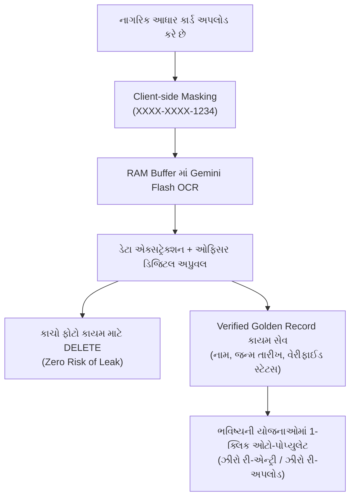

# 🛡️ NagrikSeva AI — સુરક્ષા, પ્રાઇવસી અને રિસ્ક મેનેજમેન્ટ આર્કિટેક્ચર
> **પ્રોજેક્ટ:** NagrikSeva AI (Government Public Welfare Assistant)  
> **તારીખ:** ૧૨ ઓક્ટોબર, ૨૦૨૬  
> **વિષય:** AI દસ્તાવેજ ચકાસણી, આધાર ડેટા પ્રાઇવસી, મહારાષ્ટ્ર સરકાર (Maha-AI) મોડેલ અને ડિજીલોકર ઇન્ટિગ્રેશન  

---

## 📌 પ્રસ્તાવના (Introduction)
જ્યારે કોઈ સરકારી કે સામાજિક કલ્યાણકારી પ્લેટફોર્મ પર ૧.૪ અબજ ભારતીય નાગરિકોના અંગત દસ્તાવેજો (Aadhaar, Ration Card, આવકના દાખલા) અને મલ્ટી-મોડલ AI (Gemini Flash) વાપરવામાં આવે છે, ત્યારે **ડેટા લીક, UIDAI નિયમોનું ઉલ્લંઘન અને સાયબર સુરક્ષાના જોખમો** સૌથી મહત્વના પડકારો બને છે.

આ ડોક્યુમેન્ટેશનમાં આપણી ચર્ચા દરમિયાન ઓળખાયેલા તમામ રિસ્ક ફેક્ટર્સ અને તેના ગવર્નમેન્ટ-ગ્રેડ ટેકનિકલ સોલ્યુશન્સનું વિગતવાર સંકલન કરવામાં આવ્યું છે.

---

## 🚨 ભાગ ૧: ઓળખાયેલા તમામ રિસ્ક ફેક્ટર્સ (Comprehensive Risk Matrix)

### ૧. આધાર અને અંગત ડેટા લીક રિસ્ક (Aadhaar & PII Privacy Risk)
* **Gemini API Data Logging:** જો ફ્રી કે પબ્લિક Google AI Studio API વપરાય, તો અસલ આધાર કાર્ડની ઈમેજ મોડેલ ટ્રેનિંગ કે રિવ્યુ માટે લોગ થઈ શકે છે.
* **Aadhaar Act 2016 નો ભંગ:** કોઈપણ બિન-સરકારી અથવા અનધિકૃત ડેટાબેઝમાં પૂરેપૂરો ૧૨-આંકડાનો અનમાસ્ક આધાર નંબર સેવ કરવો કાનૂની રીતે ગુનો છે.
* **DPDP Act 2023 (ડેટા પ્રોટેક્શન):** નાગરિકની સ્પષ્ટ સંમતિ (Consent) અને ન્યૂનતમ ડેટા પ્રિન્સિપલ (Data Minimization) વિના અંગત માહિતી પ્રોસેસ કરવાથી ભારે કાનૂની દંડ થઈ શકે છે.

### ૨. AI મોડેલ સંબંધિત જોખમો (Gemini Flash Vision Risks)
* **ખોટા દસ્તાવેજ પાસ થઈ જવા (Counterfeits / False Acceptance):** Photoshop કે Canva વડે એડિટ કરેલા નકલી આધાર કાર્ડ કે પ્રમાણપત્રને AI મોડેલ માત્ર વિઝ્યુઅલ ટેક્સ્ટ જોઈને અસલ માની લેવાનું જોખમ રહે છે.
* **વાસ્તવિક નાગરિકો રીજેક્ટ થઈ જવા (False Rejections):** ગ્રામીણ નાગરિકોના જૂના, ઝાંખા કે ગડી વળી ગયેલા અસલ રેશન કાર્ડને AI ઓછો ક્વોલિટી સ્કોર આપીને નકારી દે, તો સાચો લાભાર્થી વંચિત રહી જાય.
* **યોજના લાભોનું હેલ્યુસિનેશન (Scheme Hallucination):** AI મોડેલ સહાયની રકમ કે પાત્રતાના નિયમો ખોટા બોલી જાય (દા.ત. ₹૧૦,૦૦૦ ના બદલે ₹૫૦,૦૦૦) તો જાહેર વિવાદ ઊભો થાય.
* **પ્રોમ્પ્ટ ઇન્જેક્શન (Visual Prompt Injection):** દસ્તાવેજના ફોટા પર ગુપ્ત સૂચનાઓ લખીને AI ને છેતરીને મંજૂરી મેળવી લેવાનો પ્રયાસ.

### ૩. મલ્ટી-મોડલ અને પેરિફેરલ ડેટા રિસ્ક
* **ઑડિયો / વૉઇસ ડેટા લીક:** નાગરિકો માઇક્રોફોનમાં બોલે ત્યારે પોતાનું નામ, આવક કે મોબાઈલ નંબર બોલે છે. જો ઑડિયો ફાઇલ સર્વર પર સેવ રહી જાય તો બાયોમેટ્રિક વૉઇસ ડેટા લીક થાય.
* **જીપીએસ લોકેશન ટ્રેકિંગ:** 'જન સેવા કેન્દ્ર લોકેટર' માંથી નાગરિકના લાઈવ GPS કો-ઓર્ડિનેટ્સ અરજી સાથે સેવ થવાથી ઘરના લોકેશનની જાસૂસીનું જોખમ.

### ૪. જાહેર કિયોસ્ક અને સાયબર કાફે સિક્યોરિટી
* **Session Hijacking:** ગામડાના લોકો ગ્રામ પંચાયત કે સાયબર કાફેના કમ્પ્યુટરમાં કામ પતાવીને **Logout કરવાનું ભૂલી જાય**, જેથી પાછળ આવનાર વ્યક્તિ તેની અંગત વિગતો જોઈ શકે.
* **Denial of Wallet / DoS Attack:** સ્પામ બોટ્સ દ્વારા સતત દસ્તાવેજ સ્કેનિંગ એન્ડપોઇન્ટ હિટ કરીને API ક્વોટા ખતમ કરી દેવો અને લાખોનું બિલ લાવી દેવું.
* **ઇન્ટરનલ સ્ટાફ થ્રેટ:** એડમિન પોર્ટલ પરથી કોઈ ક્લાર્ક નાગરિકોનો ડેટા એક્સેલ શીટમાં ડાઉનલોડ કરીને લીક કરી શકે.

---

## 🏛️ ભાગ ૨: રિયલ-વર્લ્ડ મોડેલ્સમાંથી શીખવા જેવી બાબતો

### ૧. ટ્રાફિક સિગ્નલ ANPR સિસ્ટમમાંથી પ્રેરણા
* ટ્રાફિક કેમેરા વાહનની નંબર પ્લેટ સ્કેન કરે છે ત્યારે **કેમેરા પાસે નાગરિકનું નામ કે સરનામું હોતું નથી**.
* કેમેરા માત્ર `પ્લેટ નંબર + સમય + સ્પીડ` NIC ના સુરક્ષિત સર્વરને મોકલે છે. 
* **આપણા માટે બોધપાઠ:** સિસ્ટમના દરેક ભાગ વચ્ચે વિભાજન (Zero-Knowledge Architecture) હોવું જોઈએ.

### ૨. મહારાષ્ટ્ર સરકારની "Maha-AI" અને "Maha-Sarathi" સિસ્ટમ
* **Sovereign Hosting:** AI મોડેલ્સ વિદેશી સર્વર પર નહીં પરંતુ રાજ્યના પોતાના **State Data Centre (SDC)** પર ચાલે છે.
* **Aadhaar Data Vault (ADV):** આધાર નંબરના બદલે એક સુરક્ષિત રેન્ડમ કી (UUID Token) વપરાય છે.
* **Human-in-the-Loop (HITL):** AI માત્ર સ્કોર આપે છે, અંતિમ મંજૂરી હંમેશા સરકારી ગેઝેટેડ ઓફિસર પોતાની ડિજિટલ સહી (DSC) થી જ આપે છે.

---

## 🛡️ ભાગ ૩: NagrikSeva AI માટેનો કાયમી સિક્યોરિટી પ્લાન

### ૧. Client-Side Masking (પ્રથમ 8 ડિજિટ માસ્કિંગ)
* નાગરિક ફોટો પસંદ કરે કે તરત જ બ્રાઉઝરમાં જ આધાર નંબર પર બ્લેક પટ્ટી ફરી જાય.
* Gemini Flash પાસે ફક્ત માસ્ક કરેલું ચિત્ર (`XXXX-XXXX-1234`) જ પહોંચશે.

### ૨. Zero Raw Document Retention + Single Golden Record સ્ટ્રેટેજી
> [!IMPORTANT]
> **શંકાનું સમાધાન:** જો અસલ ફોટો ડિલીટ કરી દઈએ તો શું કર્મચારીએ કે નાગરિકે બીજી વાર એન્ટ્રી કરવી પડે?  
> **જવાબ: ના!**

* **શું ડિલીટ થશે:** જોખમી અને ભારે કાચી ઈમેજ (Raw JPG/PDF) પ્રોસેસિંગ પૂરું થતાં જ RAM માંથી કાયમ માટે ડિલીટ થશે.
* **શું સચવાશે:** એકવાર તલાટી કે અધિકારી દ્વારા દસ્તાવેજ ચકાસાઈ જાય એટલે નાગરિકની **"Verified Master Profile"** ડેટાબેઝમાં કાયમ સચવાશે.
* **ફાયદો:** ભવિષ્યમાં બીજી કોઈ પણ યોજના (દા.ત. કિસાન સહાય કે આવાસ યોજના) માટે અરજી કરતી વખતે નાગરિકે ફરીથી આધાર કાર્ડ અપલોડ નથી કરવું પડતું; ૧-ક્લિકમાં જૂનો વેરિફાઇડ રેકોર્ડ આપોઆપ ઓટો-પોપ્યુલેટ થઈ જાય છે!

---

## 📲 ભાગ ૪: DigiLocker ઇન્ટિગ્રેશન મિકેનિઝમ

### ❓ શું નાગરિકે ડિજીલોકરમાં દસ્તાવેજ અપલોડ કરવા પડે?
**બિલકુલ નહીં!** ડિજીલોકર કોઈ ગૂગલ ડ્રાઈવ નથી જ્યાં જાતે ફોટો મૂકવો પડે. તે એક સરકારી ડિજિટલ સેતુ છે:
* **આધાર:** UIDAI દ્વારા સીધું જોડાયેલું છે.
* **માર્કશીટ:** ગુજરાત બોર્ડ (GSEB) ના ડેટાબેઝમાંથી સીધી આવે છે.
* **ડ્રાઇવિંગ લાયસન્સ / RC:** RTO ના વાહન/સારથી સર્વરમાંથી સીધું આવે છે.

### 🔄 નાગરિક માટેનો ફ્લો (User Flow):
1. નાગરિક પોર્ટલ પર **"Verify via DigiLocker"** બટન દબાવશે.
2. સરકારી ઓથેન્ટિકેશન પોપ-અપમાં પોતાનો આધાર OTP નાખીને સંમતિ આપશે.
3. ૧ સેકન્ડમાં ઓફિશિયલ સરકારી સર્વરમાંથી ડિજિટલ સાઇન કરેલો ૧૦૦% અસલ દસ્તાવેજ આપણી એપને મળી જશે.
4. **પરિણામ:** 
   * બનાવટી દસ્તાવેજનો સ્કોપ ૦% થઈ જાય છે.
   * આપણી એપ પર Gemini Flash નો API લોડ અને બિલ ઘટે છે.

---

## 🔒 ભાગ ૫: પબ્લિક કિયોસ્ક અને API ડિફેન્સ ચેકલિસ્ટ

1. **Auto Session Timeout:** ૨ મિનિટ સુધી માઉસ કે કીબોર્ડ એક્ટિવિટી ન થાય તો કિયોસ્ક ઓટોમેટિક લોગઆઉટ થાય.
2. **Zero Cache Policy:** બ્રાઉઝર હિસ્ટ્રીમાં નાગરિકનો ડેટા ન રહે તે માટે `Cache-Control: no-store` હેડર્સ.
3. **In-Memory Audio Processing:** વોઇસ ચેટમાં બોલાયેલો અવાજ ક્યારેય MP3/WAV તરીકે સેવ ન થાય; માત્ર રિયલ-ટાઇમ ટેક્સ્ટ જ પ્રોસેસ થાય.
4. **Geo-Fencing (No Raw GPS):** જન સેવા કેન્દ્ર માટે ચોક્કસ લેટિટ્યુડ/લોન્ગિટ્યુડ ન સાચવતા માત્ર તાલુકો કે જિલ્લો જ રેકોર્ડ કરવો.
5. **Rate Limiting & DDoS રક્ષણ:** પ્રતિ IP એડ્રેસ ૧ મિનિટમાં મહત્તમ ૫ સ્કેનિંગ રિક્વેસ્ટની મર્યાદા.
6. **Immutable Audit Logs:** કોઈ પણ સરકારી ક્લાર્ક ક્યારે અને કોની પ્રોફાઇલ જોઈ તેનું સંપૂર્ણ લોગિંગ.

---

## 🏆 પ્રેઝન્ટેશન & જ્યુરી સમરી પિચ (One-Line Impact)
> *"NagrikSeva AI એ માત્ર યોજના શોધવાનું ટૂલ નથી, પરંતુ **Zero Raw Document Retention**, **DigiLocker Verification**, અને **Aadhaar Data Vault** સિદ્ધાંતો પર બનેલું એક **સાર્વભૌમ (Sovereign) અને નાગરિક-સુરક્ષિત ગવર્નન્સ પ્લેટફોર્મ** છે."*
